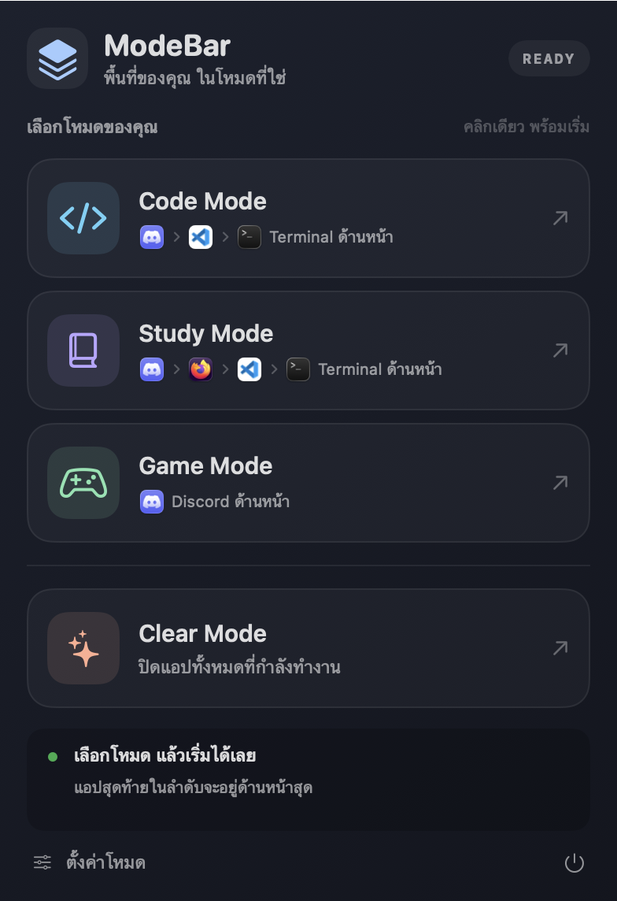

# ModeBar

A native macOS menu bar app that opens the apps you need for coding, studying, or gaming, and clears your workspace when you are done.

Created by [HopeZaa](https://github.com/HopeZaa).

Click the stacked-layers icon in the menu bar to choose a mode. ModeBar launches apps in order and brings the last app to the foreground.



## Default modes

| Mode | Launch order | Foreground app |
| --- | --- | --- |
| Code | Discord → Visual Studio Code → Terminal | Terminal |
| Study | Discord → Firefox → Visual Studio Code → Terminal | Terminal |
| Game | Discord | Discord |
| Clear | Quit running user apps, including eligible menu bar apps | Finder and ModeBar stay open |

Study Mode opens [MyCourseVille](https://www.mycourseville.com/) in Firefox, using the browser's existing profile and sign-in state. The other modes do not open this website.

Code, Study, and Game modes leave other running apps open. Use Clear Mode to close your workspace first if needed.

Clear Mode sends normal quit requests. Apps may ask you to save unfinished work. After 15 seconds, ModeBar lists any apps that are still running so you can return to them. It does not force quit apps or discard unsaved work. System agents and nested app helpers are excluded.

## Customize your modes

Open **ตั้งค่าโหมด** (Mode Settings) at the bottom of the panel, or right-click the menu bar icon.

- Add or remove apps for each mode.
- Use the arrows to change launch order. The last app is brought to the foreground.
- Restore each mode's defaults.
- Choose whether Clear Mode also quits menu bar apps.
- Enable launch at login.

The interface currently uses Thai labels and English mode names. Hold Command and drag the menu bar icon to reposition it.

## Requirements

- An Apple Silicon Mac.
- macOS 14 or later.
- Xcode Command Line Tools or an Xcode installation with a Swift compiler and a macOS SDK.

There are no third-party package dependencies. ModeBar uses AppKit, SwiftUI, ServiceManagement, and UniformTypeIdentifiers.

## Build and run

Clone this repository and run the build script from its root:

```sh
./build.sh
open ./build/ModeBar.app
```

The script builds an arm64 app bundle at `build/ModeBar.app` and applies an ad-hoc code signature for local use. You can pass another build directory as the first argument:

```sh
./build.sh build-local
```

To install it, quit any earlier copy of ModeBar, copy `build/ModeBar.app` into Applications, and open that copy. Enable launch at login in Mode Settings if desired.

The build is intended for local use. It is not Developer ID signed or notarized for public binary distribution.

## Test

Run the automated tests after building:

```sh
./build/ModeBar.app/Contents/MacOS/ModeBar --self-test
```

The tests use a simulated system to check launch order, foreground activation, the Study URL, settings, missing apps, launch failures, overlapping clicks, and Clear Mode behavior. They do not launch or quit your apps.

Inspect the default app paths without switching modes:

```sh
./build/ModeBar.app/Contents/MacOS/ModeBar --diagnostics
```

Optional integration checks open the actual default apps and verify the foreground app. The Study check also opens MyCourseVille in Firefox:

```sh
./build/ModeBar.app/Contents/MacOS/ModeBar --verify-mode code
./build/ModeBar.app/Contents/MacOS/ModeBar --verify-mode study
./build/ModeBar.app/Contents/MacOS/ModeBar --verify-mode game
```

Clear Mode is intentionally unavailable through `--verify-mode`. `Tools/VerifyClear.swift` provides a separate test harness that restricts quit requests to two disposable fixture apps.

## Project layout

```text
Sources/       App lifecycle, mode runner, settings, and SwiftUI views
Tests/         Automated tests with a simulated system
Resources/     App metadata and generated app icon
Tools/         Icon generation, preview rendering, and Clear Mode fixtures
docs/images/   A preview rendered from the app's own interface
build.sh       Dependency-free build script
LICENSE        GNU General Public License v3.0
```

## Privacy

ModeBar stores settings locally in macOS UserDefaults. It does not read browser profiles, passwords, cookies, or MyCourseVille account data, and it does not collect telemetry or make direct network requests. Study Mode asks Firefox to open the public MyCourseVille URL; the browser and website handle the connection and sign-in.

The public source uses the generic bundle identifier `org.modebar.ModeBar`. Build artifacts, compiler caches, local configuration, signing credentials, and common editor metadata are excluded by `.gitignore`. The preview image is rendered from the app's own interface and contains no browser content or account information.

Accessibility, Screen Recording, and Full Disk Access permissions are not required for the implemented mode actions.

## Uninstall

Turn off launch at login in Mode Settings, quit ModeBar, and move its app bundle from Applications to the Trash.

## License

Copyright (C) 2026 HopeZaa.

ModeBar is licensed under the **GNU General Public License v3.0 only** (`GPL-3.0-only`). See [LICENSE](LICENSE) for the complete terms.
